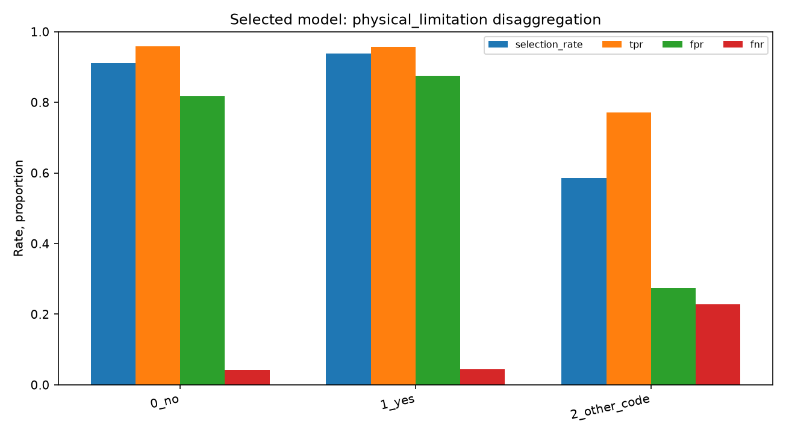
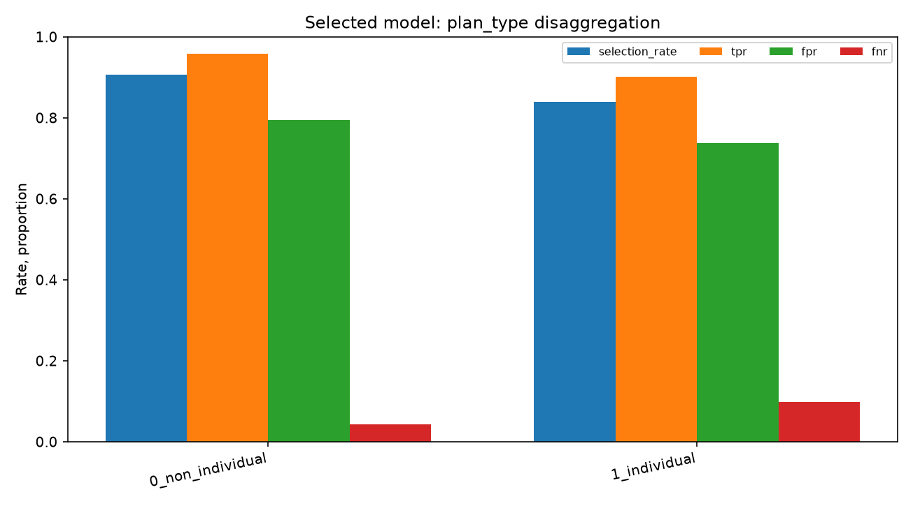

# FairAudit: Bias and Fairness Assessment of a Public Machine-Learning Dataset

FairAudit runs a reproducible, group-disaggregated evaluation of a prediction model built on a public dataset. It reports how the model performs across groups; it does not declare a model or an institution fair or unfair. The dataset is the public-domain ten-variable RAND Health Insurance Experiment (`statsmodels.datasets.randhie`), not UCI Adult. No patient-level rows are checked into this repository.

The model predicts `Y = 1(mdvis > 0)`, whether an observation records at least one outpatient physician visit. That is observed utilization, not medical need, adequate care, clinical quality, or a recommended access decision. Groups are (1) recorded physical-limitation codes and (2) individual-deductible vs other plan assignment. Additional intersectional counts are retained. The outcome and covariates come from a historical, restricted RAND study sample, so the model is not suitable for deployment.

## Reproduction — from repository root

Run the commands below from the repository root. `scripts/prepare_dataset.py` needs no downloads; the dataset rows ship with statsmodels. See `docs/troubleshooting.md` if an install fails.

```bash
python3 -m venv .venv
source .venv/bin/activate                   # Windows PowerShell: .venv\Scripts\Activate.ps1
python -m pip install --upgrade pip
python -m pip install -e '.[test,app]'       # core Fairlearn is a required dependency
python -m pip install -e '.[aif360]'         # OPTIONAL, separately; see compatibility notes
python scripts/prepare_dataset.py           # load, fingerprint, inspect, validate; no download required
python scripts/train_model.py               # fit dummy, logistic, forest; saves model and audit
python scripts/run_audit.py                 # reproducible evaluation at threshold 0.5
python scripts/run_audit.py --mitigation    # optional development-only reweighing experiment
python scripts/generate_report.py          # rerender MD/HTML and PNGs from run.json
python -m streamlit run app/streamlit_app.py
python -m pytest -q
```

`python scripts/compare_mitigation.py` is an alias for re-running the experiment and its held-out comparison. To keep prior runs, pass `--output results/<named-run>` to `scripts/run_audit.py`; the dashboard reads `results/latest` by default. `train_model.py`, `run_audit.py`, and `compare_mitigation.py` all reuse the same deterministic held-out split, so do not run them expecting independent test samples. Install test dependencies with `python -m pip install -e '.[test]'`. Installs need network access once; the dataset rows themselves ship with statsmodels.

Fairlearn is a required dependency and powers the main fairness metrics: `fairlearn>=0.12,<0.15` provides MetricFrame and the demographic parity, equalized odds, and equal opportunity methods. AIF360 is an optional extra that supplies the official pairwise test. Install it separately with a compatible interpreter (Python 3.11 or 3.12 if transitive dependency problems come up) and run the optional integration test. AIF360 is not part of the main fit pipeline.

## Experimental design (precommitted in `configs/`)

- **Positive outcome:** at least one recorded outpatient MD visit. Negative means none recorded. Neither equates to medical eligibility.
- **Features:** `lncoins`, `lpi`, `fmde`, `disea`, `hlthg`, `hlthf`, `hlthp`. `mdvis` is excluded as label leakage; `physlm` and `idp` are excluded from predictors and reserved for evaluation, though correlated proxies remain possible. No identified personally sensitive data are exported.
- **Physical-limitation groups:** exact raw 0 maps to `0_no`, exact raw 1 maps to `1_yes`, and every fractional or other code maps to `2_other_code` rather than being discarded or treated as its own disability category. **Plan type:** `idp=0` vs `idp=1`.
- **Split:** group-shuffle based on a hash of all observed input feature and audit-source columns, not the outcome, with 25% intended test; training-side validation is 25% of development. Exact observed profiles are kept together. Participants, households, calendar years, and sites cannot be separated because identifiers are absent, so a person-disjoint split is not possible with these data.
- **Preprocessing:** median-impute then standardize via a scikit-learn Pipeline and ColumnTransformer, fit only within each appropriate training segment; no leakage from final held-out observations.
- **Selection:** dummy (prior), logistic (`C=1`, max 1200) and random forest (150 trees, min leaf 12) use fixed hyperparameters. Choose the highest validation balanced accuracy, preferring the simpler model in a tie within 0.002. Refit each estimator on development and evaluate once at fixed threshold 0.5. Do not tune on test-group metrics. The sweep of 0.2–0.8 is *descriptive only*.
- **Metrics:** conventional confusion counts, accuracy, balanced accuracy, precision, recall/TPR, specificity, FPR, FNR, F1, ROC-AUC; for every reported group: `n`, positive/negative labels, TP/TN/FP/FN, selection, precision, TPR/FPR/FNR and Wilson proportion intervals; DP difference and ratio, equalized odds difference and ratio, equal opportunity difference, undefined denominator safeguards, small-group flags. MetricFrame runs when Fairlearn is installed; otherwise the package uses its own contingency-count engine, which computes the same counts directly.
- **Uncertainty:** Wilson intervals and exploratory within-group row bootstrap quantiles. Because cluster structure and repeated persons may exist, these are not guaranteed confidence-coverage intervals. No p-values, legal threshold/4/5 compliance claims, or causal conclusions.
- **Optional mitigation:** a nonproduction sample reweighing experiment fits group-label weights using only development records. It holds the original model and test rows unchanged; weights do not require test labels. Targeted group representation can improve one fairness metric while harming others.

## Demonstration run

The checked-in `results/latest/run.json` records one reproducible demonstration run of the audit pipeline over the public RAND HIE extract: the split sizes, the model selected and the group-disaggregated metric tables. It shows the framework working end to end on a public dataset rather than reporting a result about any deployed model. See `results/latest/findings.md` for the group tables, counts, non-causal interpretation, bootstrap limitations and experimental mitigation outcomes.

## Repository inventory

```text
bias-and-fairness-audit/
  README.md  LICENSE  CONTRIBUTING.md  .gitignore
  pyproject.toml  requirements.txt
  configs/{dataset,model,fairness,mitigation}.yaml
  src/fairaudit/
    audit.py  config.py
    data/{loader,validation,splitting}.py
    models/{training,evaluation}.py
    fairness/{group_analysis,fairlearn_metrics,aif360_metrics,uncertainty,threshold_analysis}.py
    mitigation/experiments.py
    reporting/{plots,findings}.py
  app/streamlit_app.py          # eight navigable pages
  scripts/{prepare_dataset,train_model,run_audit,compare_mitigation,generate_report}.py
  tests/unit/ tests/integration/
  data/README.md               # no confidential or source rows committed
  results/latest/              # JSON, models, PNGs, Markdown & HTML
  docs/{dataset_provenance,methodology,metrics,mitigation,limitations,troubleshooting}.md
```

## Interpretation boundaries

This dataset has 17,430 repeated predictor/group profiles (11,065 exact original-row duplicates), 9 distinct fractional `physlm` codes, no meaningful patient or site identifiers, and no confirmed timing of some predictors relative to utilization. The documented field means binary physical limitation, so fractional records make any third group provisional. Group base-rate and selection differences are descriptions, not evidence of bias in observation, algorithmic disparate treatment, or clinical harm; a single parity measure likewise does not establish fairness. Threshold and mitigation choices need a fresh held-out dataset before they support independent performance claims.

## Sources and usage

- RAND HIE in statsmodels: https://www.statsmodels.org/stable/datasets/generated/randhie.html (dataset-specific **public domain**)
- RAND study design, population and site sampling: https://www.icpsr.umich.edu/web/NACDA/studies/6439/
- Fairlearn documented assessment API: https://fairlearn.org/v0.13/api_reference/index.html
- AIF360 documented scikit metrics: https://aif360.readthedocs.io/en/stable/modules/sklearn.html

Code license: MIT. The dataset is public domain with attribution per statsmodels; its exact content hash is recorded in `run.json`. Do not use this artifact to make or justify access-to-care decisions.

## Real-data run (1 September 2026)

Executed end to end (`prepare_dataset`, `train_model`, `run_audit`, `run_audit --mitigation`, `generate_report`, and the
test suite: 17 passed, 1 skipped because AIF360 is optional and was not installed) on the RAND Health Insurance
Experiment extract bundled with statsmodels (20,190 rows), on a Modal container. Reports are in `results/latest/` and
`results/mitigation/`.

- Selected model: random forest (chosen on training-side validation balanced accuracy, not on fairness scores).
- Held-out test set: 5,061 records. Accuracy 0.709, balanced accuracy 0.583, ROC-AUC 0.667.
- Across physical-limitation groups: demographic-parity difference 0.351, equalized-odds difference 0.602.

Group-disaggregated rates from the same run:





Threshold sensitivity and group population figures are in `results/latest/figures/`, with the parallel mitigation run in `results/mitigation/`.

These are descriptive associations on a historical dataset, not a finding that any model or institution is unfair.
See `results/latest/findings.md` for the data-quality caveats (no person identifiers, so independence between rows
cannot be established).
